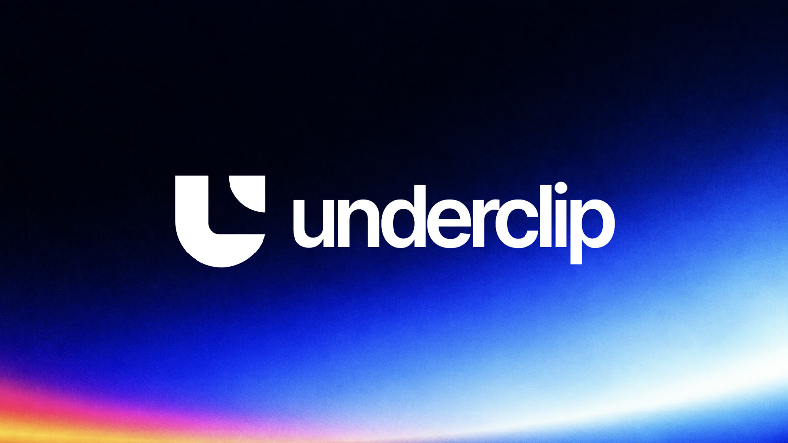

  

<h3 align="center">Reverse-engineering the edits you love.</h3>

See an edit. Make it yours.

---

underclip makes short-form video edits.

Drop in any TikTok, Reel or Short you like. underclip watches it frame by frame and works out how it was made: where it cuts, how the camera moves, the flashes and blurs, the transitions, the text, the grade, and how all of it sits on the beat. Then it rebuilds that edit on your footage.

Nothing is baked in. Every effect stays a keyframe you can change, or ask Claude to.

### What it does

- **Copies an edit.** Cuts, zooms, shakes, flashes, wipes, dissolves, colour and on-screen text, matched to the original frame by frame and timed to its sound.
- **Templates.** Every edit you copy becomes a template. Open one, swap in your own clips slot by slot, and compare it side by side with the original.
- **Edits on the beat.** Give it footage and a song and it cuts an edit with captions, effects and a matched grade.
- **3D edits.** Character lineups, select screens and starfield intros built from your scenepacks.
- **Your After Effects presets.** Import shake, zoom, text and colour presets and underclip uses them, no plugins needed.
- **Renders anywhere.** On your Mac, on a render server, or on a gaming PC on your network.

### Status

Early access, invite only. Find us at [underclip.com](https://underclip.com).
